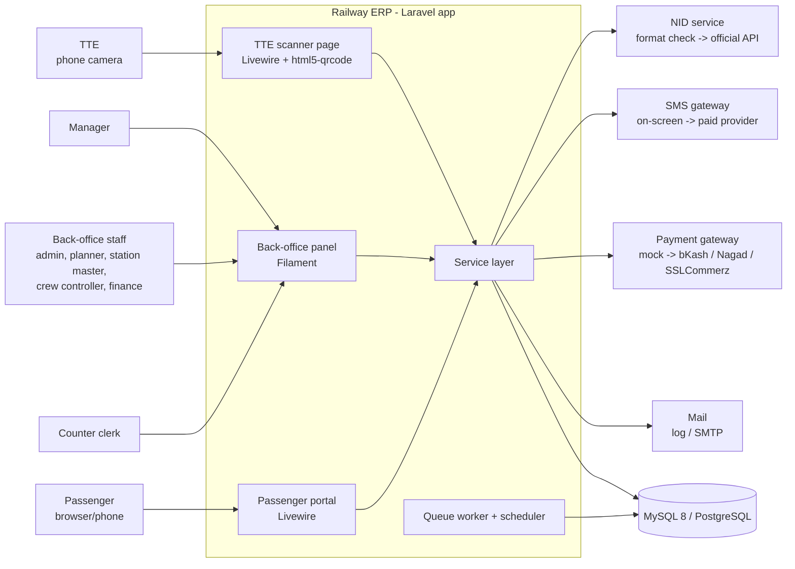
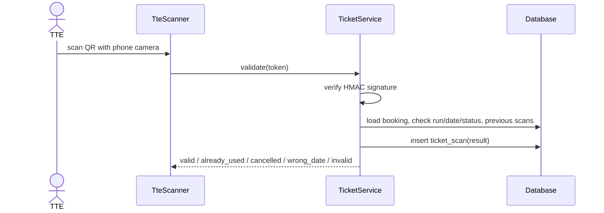
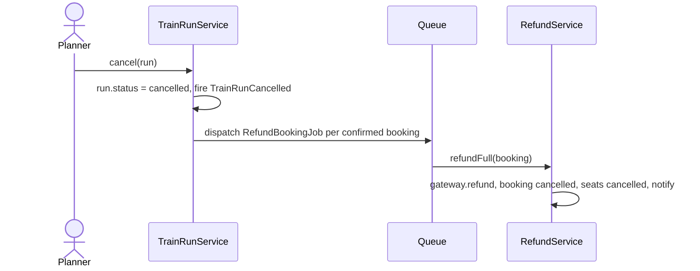

# Railway ERP — Architecture and Phase-by-Phase Delivery

Nov 1, 2026

## 1. Overview

Railway ERP is a single Laravel web application that runs a passenger railway end to end. It covers network and timetable setup, coach and seat configuration, online and counter reservations, payments and refunds, on-train ticket checking, staff and locomotive management, and revenue and operations reporting.

This document explains **how the system is built** (architecture) and **how to take it from an empty folder to production** (phases). It extends [railway-erp-prototype-plan.md](railway-erp-prototype-plan.md), which defines the prototype scope, tech stack, demo data and test scenarios. Where the two documents overlap, the prototype plan is the source of truth for prototype scope.

**Guiding principles**

- **One app, many roles.** A single codebase with role-based menus instead of separate apps.
- **Business logic lives in services.** Controllers, Livewire components and Filament resources stay thin.
- **Mocks sit behind interfaces.** Payments, SMS and NID checks use contracts, so real providers can replace them without touching the booking flow.
- **Correct first, scalable later.** Database row locks guarantee no double sales in the prototype; Redis and queues come in production.

---

## 2. Architecture

### 2.1 System context



### 2.2 Layers

| Layer | What lives here | Examples |
| --- | --- | --- |
| **Presentation** | Screens and HTTP entry points. No business rules. | Filament resources and widgets, Livewire pages (`SearchTrains`, `SeatMap`, `Checkout`, `MyBookings`, `TteScanner`), `PaymentController` callback |
| **Application (services)** | Use cases and transactions. Each method does one business action. | `SeatInventoryService`, `FareService`, `PaymentService`, `RefundService`, `TicketService`, `TrainRunService`, `CrewService`, `ReportService` |
| **Domain** | Data and rules attached to it. | Eloquent models, status enums, domain events (`BookingConfirmed`, `TrainRunCancelled`), policies |
| **Infrastructure** | Talking to the outside world. Always behind a contract. | `PaymentGateway` (`MockGateway`, later `BkashGateway`…), `SmsSender` (`LogSmsSender`, later a real provider), `NidVerifier`, PDF (dompdf), QR, Excel export |

Rule: presentation calls services, services call models and contracts, and nothing calls upward.

**Swappable integrations** are bound in `AppServiceProvider` based on config:

```php
interface PaymentGateway
{
    public function startCheckout(Payment $payment): string;           // returns redirect URL
    public function verifyCallback(Request $request): GatewayResult;   // signature check, status, txn id
    public function refund(Payment $payment, int $amountPoisha): GatewayResult;
}

// AppServiceProvider::register()
$this->app->bind(PaymentGateway::class, fn () => match (config('services.payment.driver')) {
    'bkash'  => new BkashGateway(config('services.bkash')),
    default  => new MockGateway(),
});
```

`SmsSender` and `NidVerifier` follow the same pattern.

### 2.3 Module map

| # | Module | Main models | Screens | Service | Depends on |
| --- | --- | --- | --- | --- | --- |
| 1 | Train and route management | `Train`, `TrainRoute`, `RouteStop` | Filament: Trains, Routes | `TrainRunService` | — |
| 2 | Station and schedule management | `Station`, `ScheduleStop`, `TrainRun` | Filament: Stations, Schedules, Actual times | `TrainRunService` | 1 |
| 3 | Coach and seat configuration | `CoachType`, `Seat`, `RakeCoach`, `Quota` | Filament: Coach types + layout editor, Rake composition | `SeatInventoryService` | 1 |
| 4 | Online ticket reservations | `Booking`, `Passenger` | Livewire: Search, Seat map, Checkout, My bookings; Filament: Counter booking | `SeatInventoryService`, `FareService`, `TicketService` | 2, 3, 5, 6 |
| 5 | Seat availability management | `SeatBooking` | Seat map, Admin seat blocking | `SeatInventoryService` | 2, 3 |
| 6 | Payment and refund processing | `Payment`, `Refund`, `RefundRule`, `FareRule`, `Concession` | Mock pay page, Filament: Transactions, Refund rules, Fare rules | `PaymentService`, `RefundService`, `FareService` | 4 |
| 7 | Ticket checking and validation | `TicketScan`, `Fine` | Livewire: TTE scanner, Passenger chart | `TicketService` | 4, 6 |
| 8 | Staff and locomotive management | `Staff`, `CrewAssignment`, `Locomotive`, `LocoAssignment`, `Maintenance` | Filament: Staff, Locos, Assignments | `CrewService` | 2 |
| 9 | Revenue and operational reports | (reads all) | Filament dashboard widgets, exports | `ReportService` | all |

Build order follows the dependency column: 1 → 2 → 3 → 5 → 4 → 6 → 7 → 8 → 9.

### 2.4 Data model

```mermaid
erDiagram
    STATION ||--o{ ROUTE_STOP : "appears in"
    TRAIN_ROUTE ||--o{ ROUTE_STOP : has
    TRAIN_ROUTE ||--o{ TRAIN : "used by"
    TRAIN ||--o{ SCHEDULE_STOP : has
    ROUTE_STOP ||--o{ SCHEDULE_STOP : "timed by"
    TRAIN ||--o{ TRAIN_RUN : "runs as"
    TRAIN ||--o{ RAKE_COACH : "composed of"
    COACH_TYPE ||--o{ RAKE_COACH : "type of"
    COACH_TYPE ||--o{ SEAT : "layout has"
    TRAIN ||--o{ QUOTA : has
    TRAIN_RUN ||--o{ BOOKING : has
    TRAIN_RUN ||--o{ SEAT_BOOKING : "inventory"
    BOOKING ||--o{ SEAT_BOOKING : holds
    BOOKING ||--o{ PASSENGER : has
    SEAT ||--o{ SEAT_BOOKING : "booked as"
    BOOKING ||--o{ PAYMENT : "paid by"
    PAYMENT ||--o{ REFUND : "refunded by"
    BOOKING ||--o{ TICKET_SCAN : "scanned in"
    BOOKING ||--o{ FINE : "may get"
    USER ||--o{ BOOKING : makes
    STAFF ||--o{ CREW_ASSIGNMENT : assigned
    TRAIN_RUN ||--o{ CREW_ASSIGNMENT : staffed
    LOCOMOTIVE ||--o{ LOCO_ASSIGNMENT : assigned
    TRAIN_RUN ||--o{ LOCO_ASSIGNMENT : hauled
    LOCOMOTIVE ||--o{ MAINTENANCE : has

    TRAIN_RUN {
        bigint id PK
        bigint train_id FK
        date journey_date
        string status
        int delay_minutes
    }
    BOOKING {
        bigint id PK
        string pnr UK
        bigint user_id FK
        bigint train_run_id FK
        int from_seq
        int to_seq
        int total_poisha
        string status
        datetime hold_until
    }
    SEAT_BOOKING {
        bigint id PK
        bigint booking_id FK "nullable for admin blocks"
        bigint train_run_id FK
        string coach_no
        bigint seat_id FK
        int from_seq
        int to_seq
        string status "held, booked, blocked, cancelled"
        datetime hold_until
    }
    PAYMENT {
        bigint id PK
        bigint booking_id FK
        string method
        string txn_id
        int amount_poisha
        string status
    }
```



**Key indexes**

- `seat_bookings (train_run_id, coach_no, seat_id, status)` for the overlap check.
- `bookings (pnr)` unique; `bookings (train_run_id, status)`.
- `train_runs (train_id, journey_date)` unique.
- `payments (txn_id)` unique, so a duplicate gateway callback can't confirm twice.

### 2.5 Status lifecycles

| Entity | States |
| --- | --- |
| `Booking` | `pending_payment` → `confirmed` → `cancelled` / `completed`; `pending_payment` → `failed` / `expired` |
| `SeatBooking` | `held` → `booked` → `cancelled`; `held` → `cancelled` (expired or failed); `blocked` (admin) |
| `Payment` | `initiated` → `success` / `failed`; `success` → `refunded` / `partially_refunded` |
| `TrainRun` | `scheduled` → `running` → `arrived`; `scheduled` → `cancelled` |
| `TicketScan.result` | `valid`, `already_used`, `cancelled`, `wrong_date`, `invalid` |

All statuses are PHP backed enums in `app/Enums`, never raw strings in code.

### 2.6 Key flows

**Booking: search → hold → pay → ticket**

```mermaid
sequenceDiagram
    actor U as Passenger
    participant SM as SeatMap (Livewire)
    participant SIS as SeatInventoryService
    participant PS as PaymentService
    participant GW as PaymentGateway (mock)
    participant TS as TicketService
    participant DB as Database

    U->>SM: pick seats (coach_no + seat_id), from/to
    SM->>SIS: hold(run, seats, fromSeq, toSeq)
    SIS->>DB: BEGIN; lock train_run row FOR UPDATE
    SIS->>DB: check overlapping held/booked/blocked
    alt seat free
        SIS->>DB: insert booking + seat_bookings (held, hold_until = now+10m); COMMIT
        SIS-->>SM: booking (10-min countdown)
    else taken
        SIS-->>SM: SeatUnavailableException
    end
    U->>PS: checkout
    PS->>GW: startCheckout(payment)
    GW-->>U: mock pay page
    U->>GW: Success / Fail / Cancel
    GW->>PS: callback
    PS->>DB: BEGIN; lock train_run row
    alt hold valid, or expired but seats still free
        PS->>DB: payment success, booking confirmed, seats booked; COMMIT
        PS->>TS: issue ticket (PDF + signed QR), email
    else expired and seats taken
        PS->>DB: payment failed; queue refund; COMMIT
    end
```

**TTE scan**



**Train run cancellation → automatic refunds**



### 2.7 Booking concurrency design

The rule is that **no seat segment is ever sold twice.**

1. **Lock scope:** every write to a run's inventory starts with `TrainRun::whereKey($id)->lockForUpdate()` inside `DB::transaction`. Writes to one run are serialised; different runs never wait on each other.
2. **Single entry point:** online booking, counter booking, admin blocking, cancellation and payment callbacks all go through `SeatInventoryService`. Nothing else writes `seat_bookings`.
3. **Overlap rule:** two segments clash when `existing.from_seq < new.to_seq AND existing.to_seq > new.from_seq` on the same `(train_run_id, coach_no, seat_id)`.
4. **Taken means** `booked`, `blocked`, or `held` with `hold_until > now()`. Expired holds stop blocking the instant they expire, even before the cleanup job runs.
5. **Cleanup:** `holds:release` runs every minute and marks expired holds `cancelled` and their bookings `expired`.
6. **Idempotent callbacks:** `payments.txn_id` is unique, and a callback for an already-final payment is ignored.
7. **Production upgrade:** add a short Redis lock in front of the DB lock and a virtual waiting room for rush days. The DB lock stays as the final guarantee.

### 2.8 Security and roles

| Permission area | Admin | Planner | Counter clerk | Station master | TTE | Crew controller | Finance | Manager | Passenger |
| --- | :-: | :-: | :-: | :-: | :-: | :-: | :-: | :-: | :-: |
| Users, roles, audit log | ✔ | | | | | | | | |
| Fare and refund rules | ✔ | | | | | | view | view | |
| Trains, routes, schedules, coaches, quotas | ✔ | ✔ | | | | | | view | |
| Counter booking and cancellation | ✔ | | ✔ | | | | | | |
| Actual times and delays | ✔ | | | ✔ | | | | view | |
| Ticket scan, passenger chart, fines | ✔ | | | | ✔ | | | | |
| Crew and loco assignment | ✔ | | | | | ✔ | | view | |
| Payments, refunds, transactions | ✔ | | | | | | ✔ | view | |
| Dashboards and exports | ✔ | | | | | | ✔ | ✔ | |
| Own bookings | | | | | | | | | ✔ |

- **spatie/laravel-permission** stores roles and permissions. Filament resources check them through Laravel policies, so the same rule protects both the menu item and the URL.
- **Passengers** use the portal only. `canAccessPanel()` keeps them out of Filament.
- **Audit:** spatie/laravel-activitylog on rules, schedules, bookings, refunds and assignments.
- **QR token:** `base64(pnr|run_id|hmac_sha256(APP_KEY, pnr|run_id))`, verified on scan.
- **Rate limits:** login, OTP and `hold()` per user/IP (Laravel `RateLimiter`).
- **Production additions:** 2FA for staff, encrypted NID fields, security audit, backups.

### 2.9 Background processing

| Job | Trigger | Purpose |
| --- | --- | --- |
| `holds:release` | Scheduler, every minute | Expire unpaid holds |
| `runs:generate` | Scheduler, daily 01:00 | Create `TrainRun` rows for the next 10 days from running days |
| `SendTicketEmail` | Queue, on `BookingConfirmed` | PDF ticket by email |
| `RefundBookingJob` | Queue, on cancellation / `TrainRunCancelled` | Calculate and execute refunds |
| `ExpiryWarnings` | Scheduler, daily | Flag licence and loco maintenance due dates |

Locally, run `php artisan schedule:work` and `php artisan queue:work` (or `composer run dev`, which starts the server, queue and Vite together).

### 2.10 Folder structure

```text
app/
  Console/Commands/        ReleaseHolds, GenerateRuns, ExpiryWarnings
  Contracts/               PaymentGateway, SmsSender, NidVerifier
  Enums/                   BookingStatus, SeatBookingStatus, PaymentStatus, RunStatus, ScanResult
  Events/ Listeners/       BookingConfirmed, TrainRunCancelled ...
  Exceptions/              SeatUnavailableException, HoldExpiredException
  Filament/
    Resources/             TrainResource, TrainRouteResource, StationResource, CoachTypeResource, ...
    Pages/                 CounterBooking, ActualTimes, AuditLog
    Widgets/               RevenueChart, OccupancyChart, PunctualityChart, StatsOverview
  Gateways/                MockGateway, (later) BkashGateway, NagadGateway, SslcommerzGateway
  Http/Controllers/        PaymentController, TicketPdfController
  Jobs/                    SendTicketEmail, RefundBookingJob
  Livewire/                SearchTrains, SeatMap, Checkout, MyBookings, TteScanner
  Models/
  Policies/
  Services/                SeatInventoryService, FareService, PaymentService, RefundService,
                           TicketService, TrainRunService, CrewService, ReportService
database/
  migrations/  factories/  seeders/ (DemoNetworkSeeder, StaffSeeder, PastBookingsSeeder)
tests/
  Unit/Services/           FareServiceTest, RefundServiceTest, SeatOverlapTest
  Feature/                 BookingFlowTest, PaymentCallbackTest, TteScanTest, RolesTest
  Concurrency/             parallel hold script (runs against MySQL)
```

### 2.11 Environments

| Environment | Where | Purpose | Notes |
| --- | --- | --- | --- |
| Local | Laravel Herd (PHP 8.4) + portable MySQL 8.4 on `127.0.0.1:3307` | Development | Mail written to the log, mock gateway. Port 3307 avoids clashing with XAMPP on 3306 |
| Demo | Dev PC + Cloudflare Tunnel / ngrok | Testers and pilot | HTTPS required for the TTE camera |
| Staging | Small VPS | Pre-production, real gateway sandboxes | Same config as prod, fake data |
| Production | Cloud or government data centre | Live service | Backups, monitoring, DR |

Important `.env` keys: `APP_TIMEZONE=Asia/Dhaka`, `DB_CONNECTION=mysql`, `QUEUE_CONNECTION=database`, `PAYMENT_DRIVER=mock`, `SMS_DRIVER=log`, `NID_DRIVER=format`, `MAIL_MAILER=log` (or `smtp` with Mailpit / Gmail), `DB_PORT=3307`.

### 2.12 Conventions

- **Money** is stored as integer **poisha** (`total_poisha`, `amount_poisha`) and never as float. Format to ৳ only in views.
- **Time:** store `datetime` in Asia/Dhaka (single-country system). Schedule times use `time` + `day_offset` for overnight trains.
- **Statuses** are enums, and transitions happen only inside services.
- **Thin UI:** a Livewire component or Filament action calls one service method.
- **Code style and tests:** run Laravel Pint and Pest on every push (GitHub Actions free tier). Every service method has a test.

---

## 3. Phase-by-phase completion

Each phase ends with something that can be demonstrated. Don't start a phase until the previous phase's exit criterion is met. Weeks assume 1–2 developers; a single developer should plan for about 8 weeks for phases 0–6.

### Summary

| Phase | Name | Duration | Demo / exit criterion |
| --- | --- | --- | --- |
| 0 | Foundation | Week 1 (first half) | All 9 test accounts log in and see their own menu; CI is green |
| 1 | Network and schedules | Week 1–2 | Planner creates a train with a timetable; runs exist for the next 10 days |
| 2 | Coaches and inventory | Week 2 | A train run shows a full seat map from its rake |
| 3 | Booking engine | Week 3 | Two parallel holds on one seat: exactly one succeeds (automated test) |
| 4 | Payments, tickets, refunds | Week 4 | Book → pay → PDF ticket → cancel → correct refund |
| 5 | Operations | Week 5 | TTE scans a ticket on a phone; crew rules block invalid assignments |
| 6 | Reports and hardening | Week 6 | Full walkthrough with all roles; all prototype test scenarios pass |
| 7 | Pilot | 2 weeks | Feedback collected from 10–20 real users; production requirements signed off |
| 8 | Production readiness | Months, by workstream | Security audit passed, load test passed, go-live |

### Phase 0 — Foundation

**Goal:** a running skeleton with login, roles and CI.

**Status: ✅ complete (Nov 1, 2026).** Repo: `Riyadhasann/Railway_management_system`.

- [x] Create the GitHub repo, `README`, `.editorconfig`. *Branch protection on `main` is optional and set in GitHub settings by the repo owner.*
- [x] `laravel new railway-erp` with the Livewire starter kit (Laravel 13, Filament 5, Livewire 4); MySQL in `.env`; `APP_TIMEZONE=Asia/Dhaka`.
- [x] Install Filament, spatie/laravel-permission, spatie/laravel-activitylog; publish migrations; migrate.
- [x] Status enums (`app/Enums`) and `Contracts/` with `LogSmsSender`, `FormatNidVerifier` bound in `AppServiceProvider`. *`PaymentGateway` + `MockGateway` moved to Phase 4 (they need the `Payment` model).*
- [x] `RolesAndPermissionsSeeder` + `DemoUsersSeeder`: 9 roles, permissions from §2.8, one test account per role.
- [x] `canAccessPanel()` (staff only) and admin `Gate::before`. *Policies and per-role navigation are added with each Filament resource from Phase 1 onwards.*
- [x] GitHub Actions: Pint + PHPStan + Pest against a MySQL 8.4 service container.

**Deliverable:** login works for every role. **Exit:** `RolesTest` passes in CI. ✅

### Phase 1 — Network and schedules (modules 1, 2)

**Goal:** the railway network and timetable exist in the system.

- [ ] Migrations and models: `Station`, `TrainRoute`, `RouteStop`, `Train`, `ScheduleStop`, `TrainRun`.
- [ ] Filament resources: Stations; Routes with a sortable stops repeater (sequence, distance_km); Trains with running days.
- [ ] Timetable editor: arrival/departure + `day_offset` per stop.
- [ ] `TrainRunService::generate()` + `runs:generate` command + scheduler entry.
- [ ] Cancel a train for one date (sets run status; refunds come in Phase 4).
- [ ] `DemoNetworkSeeder`: 12–15 stations, 2–3 routes, 6 trains.

**Exit:** the planner demo works; `GenerateRunsTest` covers running days and overnight trains.

### Phase 2 — Coaches and inventory (modules 3, 5)

**Goal:** every train run knows its seats.

- [ ] `CoachType`, `Seat`, `RakeCoach`, `Quota` migrations and resources.
- [ ] **Seat-layout grid editor** (custom Filament page: rows × columns, click to place a seat or berth, set flags such as women-only). *Highest-risk custom UI, so time-box it to 3 days; fall back to a simple table form.*
- [ ] Rake composition per train (ordered coaches with `coach_no`).
- [ ] `SeatInventoryService::availability(run, fromSeq, toSeq)` returns the per-coach seat states.
- [ ] Read-only seat map component used by both back-office and portal.
- [ ] Admin seat blocking (`SeatBooking` with status `blocked`).

**Exit:** a run's seat map renders correctly for every coach type; blocked seats show as unavailable.

### Phase 3 — Booking engine (modules 4, 5)

**Goal:** seats can be held safely, by passengers and at the counter.

- [ ] `FareService::quote()` from `FareRule` (class × distance band) + `Concession`.
- [ ] `SeatInventoryService::hold()` as in the prototype plan (train-run lock, `coach_no + seat_id`, overlap rule).
- [ ] `TicketService::newPnr()` (unique, no 0/O/1/I, retry on collision).
- [ ] Livewire `SearchTrains` → `SeatMap` (with `wire:poll`) → `Checkout` with a 10-minute countdown; up to 4 passengers; NID format check; OTP shown on screen.
- [ ] Counter booking page in Filament using the same service.
- [ ] `holds:release` command.
- [ ] **Concurrency test:** a script fires 20 parallel `hold()` requests for one seat against MySQL; assert exactly one booking.

**Exit:** concurrency test passes; segment booking A→B + B→C on one seat works.

### Phase 4 — Payments, tickets and refunds (module 6)

**Goal:** money flow and tickets, end to end, on the mock gateway.

- [ ] `PaymentGateway` contract (moved from Phase 0) bound in `AppServiceProvider`.
- [ ] `Payment`, `Refund`, `RefundRule` migrations; Filament transaction list and refund-rule editor.
- [ ] `MockGateway` pay page (bKash / Nagad / Card styling) with Success / Fail / Cancel.
- [ ] `PaymentService::handleCallback()`: idempotent on `txn_id`, re-takes the train-run lock, late-payment rule.
- [ ] `TicketService::issue()`: signed QR token, dompdf ticket, `SendTicketEmail` job.
- [ ] Passenger and counter cancellation → `RefundService::calculate()` from hours-before-departure rules.
- [ ] `TrainRunCancelled` → `RefundBookingJob` for every confirmed booking.

**Exit:** the prototype "Booking and payment" and "Refunds" scenarios all pass.

### Phase 5 — Operations (modules 2, 7, 8)

**Goal:** the train-side and staff-side of the railway.

- [ ] `TteScanner` page (html5-qrcode), `TicketService::validate()`, `TicketScan` records; test over the HTTPS tunnel on a real phone.
- [ ] Passenger chart per run (printable), mark no-show, record `Fine`.
- [ ] Station master actual-time entry → `delay_minutes` → shown on passenger bookings.
- [ ] `Staff`, `Locomotive`, `Maintenance` resources; licence expiry and maintenance due fields.
- [ ] `CrewService::assignCrew()` / `assignLoco()`: block expired licences and locos under repair; `ExpiryWarnings` job.

**Exit:** the prototype "Operations" scenarios pass on a real phone.

### Phase 6 — Reports and hardening (module 9)

**Goal:** management visibility and a demo-ready build.

- [ ] `ReportService` queries; Filament widgets: daily revenue, revenue by train/class/channel, occupancy %, refunds, on-time %.
- [ ] Excel/CSV exports (maatwebsite/excel).
- [ ] Audit log page.
- [ ] `PastBookingsSeeder` (30 days of history); "Reset demo data" admin action.
- [ ] Bug-fix pass, N+1 query check (Laravel Debugbar), basic indexes from §2.4.
- [ ] Tester guide (one page per role) and share the demo over the HTTPS tunnel.

**Exit:** a full walkthrough with all roles; every checkbox in the prototype plan's test scenarios is ticked.

### Phase 7 — Pilot

**Goal:** validate with real users before investing in production.

- [ ] 10–20 users: counter clerks, a TTE, a station master, passengers; 1–2 weeks.
- [ ] Feedback log (GitHub Issues with labels `bug`, `ux`, `missing-feature`).
- [ ] Weekly fix releases; measure task completion and errors per role.
- [ ] Write the production requirements: confirmed scope, volumes (bookings/day, peak), integrations, compliance.

**Exit:** production requirements signed off by the railway stakeholders.

### Phase 8 — Production readiness

Run these as parallel workstreams once the pilot is signed off.

| Workstream | Work | Notes |
| --- | --- | --- |
| Payments | Real `BkashGateway`, `NagadGateway`, `SslcommerzGateway`; settlement reconciliation; refund API | Merchant approval can take weeks, so start applying during the pilot |
| Messaging and identity | Real `SmsSender` for OTP and alerts; official `NidVerifier` | Contracts already exist; only adapters change |
| TTE app | Offline-first handheld app (PWA or native) with a downloaded passenger chart and later sync | Needs a sync and conflict design |
| Scale | Redis cache and locks, queue on Redis + Horizon, virtual waiting room, read replicas, load test for festival peaks | DB lock stays as the final guarantee |
| Reporting | Separate reporting store / nightly snapshots so reports don't load the booking DB | |
| Security | 2FA for staff, NID encryption at rest, OWASP review, external security audit, rate limits, WAF | |
| Infrastructure | Production hosting, staging, automated backups, monitoring/alerting, DR plan, zero-downtime deploys | |
| Go-live | Data migration (stations, trains, staff), staff training, phased rollout (one route first), support rota | |

**Exit:** load test meets the peak target, security audit is closed, rollback plan rehearsed, go-live approved.

---

## 4. Definition of done and testing

**A feature is done when:**

- [ ] Business logic is in a service method, with a unit or feature test.
- [ ] Permissions are enforced by a policy, and tested for at least one allowed and one denied role.
- [ ] Changes to important records are written to the audit log.
- [ ] Pint and Pest pass in CI.
- [ ] It's demoed to the team at the end of the phase.

**Testing strategy**

| Level | What | Tool |
| --- | --- | --- |
| Unit | Fare calculation, refund rules, overlap rule, QR signing | Pest |
| Feature | Booking flow, payment callback (success/fail/late/duplicate), TTE scan results, role access | Pest + `RefreshDatabase` on MySQL |
| Concurrency | Parallel holds on one seat | Script against MySQL (not SQLite) |
| Manual | Prototype plan test scenarios, per role | Tester walkthrough |
| Load (production) | Search and hold at peak volume | k6 or JMeter |

---

## 5. Risks and mitigations

| Risk | Impact | Mitigation |
| --- | --- | --- |
| Seat-layout editor takes too long | Phase 2 slips | Time-box to 3 days; fall back to a table-based seat form |
| Double booking under load | Loss of trust | Train-run lock, single service entry point, automated concurrency test from Phase 3 |
| Scope creep from pilot feedback | Prototype never finishes | Log requests; anything outside the prototype plan goes to Phase 8 |
| TTE camera blocked on HTTP | Scanner fails in demo | Always share over the HTTPS tunnel; test on a real phone in Phase 5 |
| Gateway merchant approval delays | Go-live slips | Start applications during Phase 7; mock stays behind the contract until approved |
| Report queries slow the booking DB | Slow booking at peak | Indexes now; separate reporting store in Phase 8 |
| Single developer | 8+ weeks instead of 6 | Keep Filament defaults; skip waitlist; cut nice-to-haves first |
